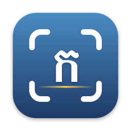
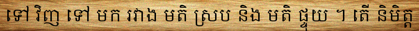
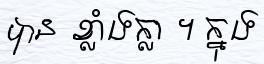
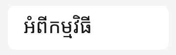
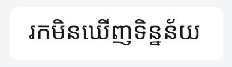
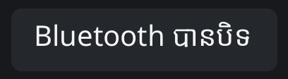

<p align="center">
  
</p>

<h1 align="center">KhmerClip</h1>

<p align="center">
  Screen OCR for <b>Khmer</b> and mixed Khmer/English text.<br>
  Select any part of the screen and the text is on your clipboard.<br>
  Runs fully on-device, on macOS, Windows and Linux.
</p>

<p align="center">
  <a href="https://github.com/KimChengSHEANG/khmerclip/releases">Download</a> ·
  <a href="#results">Results</a> ·
  <a href="#training-data">Training data</a> ·
  <a href="#build-from-source">Build from source</a> ·
  <a href="docs/PROJECT.md">Project guide</a>
</p>

---

Apple's Vision framework, and most OCR tools, can't read Khmer. KhmerClip ships its own engines: a TrOCR model fine-tuned on over a million Khmer and English text lines, and Tesseract as a lightweight fallback. On our 200-image benchmark the fine-tuned model has a **0.44% character error rate**. Stock Tesseract has 25.8% on the same images.

## Features

| | macOS | Windows / Linux |
|---|:---:|:---:|
| Drag-select screen capture, global hotkey | ✅ | ✅ |
| Auto-copy to clipboard, result popup, history | ✅ | ✅ |
| OCR an image file | ✅ | ✅ |
| Launch at login, update check | ✅ | ✅ |
| Engines: Tesseract (default) and Khmer TrOCR | ✅ CoreML | ✅ ONNX, downloaded on first use |
| Capture a whole window (Space while selecting) | ✅ | — |
| QR / barcode scanning | ✅ | — |
| Khmer text-to-speech, on-device translation | ✅ | — |

Choose the engine in **Preferences → OCR Engine**. Tesseract is the default. **TrOCR** is far more accurate on Khmer (see [Results](#results)).

## Download

Builds will be on the [Releases](https://github.com/KimChengSHEANG/khmerclip/releases) page. Until the first release is out, [build from source](#build-from-source).

The builds are unsigned:

- **macOS 15+ (Apple Silicon):** unzip and move KhmerClip to Applications. The first time, right-click → Open, or run `xattr -dr com.apple.quarantine /Applications/KhmerClip.app`. Grant **Screen Recording** when asked.
- **Windows:** run `KhmerClip-<ver>-windows-x64-setup.exe`. SmartScreen warns on first run: More info → Run anyway.
- **Linux:** `chmod +x KhmerClip-<ver>-x86_64.AppImage`, then run it. On Wayland, bind a desktop shortcut to `KhmerClip-…AppImage --capture`. GNOME needs the AppIndicator extension for the tray icon.

The Windows/Linux TrOCR model (~1.3 GB) downloads on first use from [`kcsheang/khmerclip-trocr-khmer-onnx`](https://huggingface.co/kcsheang/khmerclip-trocr-khmer-onnx). The app checks it against a pinned commit and SHA-256.

## Results

### Benchmark

All engines are scored on one frozen set of 200 line images ([`training/eval`](training/eval)). The metric is **CER** (character error rate, lower is better), averaged per image.

| Subset | Images | What it is |
|---|---:|---|
| printed | 89 | Scanned/printed lines from the SoyVitou test split |
| ui | 88 | App-style Khmer strings rendered in Noto Sans Khmer |
| mixed | 23 | Lines with both Khmer and Latin letters or digits |

| Engine (on-device, Apple Silicon) | CER all | printed | ui | mixed | Median latency |
|---|---:|---:|---:|---:|---:|
| Tesseract 5 `khm+eng` (stock `tessdata_fast`) | 0.2580 | 0.5370 | 0.0199 | 0.0894 | ~76–108 ms |
| TrOCR v0, before fine-tuning on new data | 0.0593 | 0.0433 | 0.0662 | 0.0950 | 95 ms |
| **TrOCR v2 + Latin-line fallback (current)** | **0.0044** | 0.0055 ¹ | **0.0032** | **0.0046** | **105 ms** |

¹ The v2 printed number is the PyTorch reference (Hugging Face, greedy). The other v2 columns are CoreML on the Mac.

> **Caveat on printed CER:** checkpoints trained before October 2026 saw the SoyVitou test split, which the printed fixtures come from. The loader is fixed, but v2 builds on those checkpoints, so its printed number is optimistic. The **ui** and **mixed** subsets were never in training data.

On the Mac, TrOCR runs as a CoreML FP16 encoder plus a stateful KV-cache decoder. That made it ~14× faster than the first port (1367 → 95 ms median), so it is now about as fast as Tesseract. When TrOCR reads a line with no Khmer and Tesseract is confident (every word ≥ 70), the app uses Tesseract's reading of that line instead. Tesseract reads clean English UI text better. This fallback took mixed CER from 0.0133 to 0.0046.

### Model progression (PyTorch reference, 200 fixtures)

| Checkpoint | CER all | printed | ui | mixed | English UI line accuracy |
|---|---:|---:|---:|---:|---:|
| v0, `checkpoint-3` (step 72k, beam 4) | 0.0542 | 0.0425 | 0.0586 | 0.0828 | — |
| v1, more data + handwriting + synthetic fonts | 0.0069 | 0.0064 | 0.0021 | 0.0271 | 62.3% |
| **v2, + clean English synthetic set (shipped)** | **0.0054** | 0.0055 | 0.0032 | **0.0133** | **76.0%** |

v1 and v2 rows use greedy decoding with the repeat-run cap, which is what the apps run. English UI line accuracy is measured on held-out English UI strings rendered in macOS system fonts that aren't in the training set ([`eval_english.py`](training/trocr/scripts/eval_english.py)). v1 also cut CER on new domains: handwriting 0.318 → 0.014, synthetic 0.056 → 0.008, Siem Reap font set 0.279 → 0.076.

### Samples

These six lines are illustrative only; see the table above for measured accuracy. Each fixture image went through the macOS `OCRBench` tool, run with stock Tesseract and with TrOCR v2.

| Image | Meaning | Tesseract | TrOCR v2 |
|---|---|---|---|
|  | "…back and forth between agreeing and opposing opinions. Is…" | ❌ 3 errors: two words merged, one word read as "a", one word misspelled | ✅ exact |
|  | "…strongly. In…" | ❌ unreadable: Latin junk ("PS BHD LS") | ✅ exact |
|  | "About the app" | ✅ exact | ✅ exact |
|  | "No data found" | ❌ 1 error: wrong vowel sign | ✅ exact |
|  | (English line) | ❌ dropped the word "I" | ✅ exact |
|  | "Bluetooth is off" (mixed Khmer/English) | ✅ exact | ✅ exact |

Full write-ups: [`finetune_v1.md`](training/eval/results/finetune_v1.md), [`trocr_speed_accuracy.md`](training/eval/results/trocr_speed_accuracy.md), [`mac_gate.md`](training/eval/results/mac_gate.md), [`baseline.md`](training/eval/results/baseline.md).

## How the model is built

- **Base:** [`microsoft/trocr-base-printed`](https://huggingface.co/microsoft/trocr-base-printed), a ViT encoder with a RoBERTa-style decoder.
- **Tokenizer:** the byte-level BPE tokenizer, plus one added token per Khmer character (U+1780–17FF, U+19E0–19FF and the zero-width separators). Each Khmer character becomes one token instead of three bytes. Labels are capped at 128 tokens.
- **Training:** HF `Seq2SeqTrainer`, bf16, on a single NVIDIA RTX 3090 (24 GB). Fine-tuning took about a month of GPU time in total. Each fine-tune continues from the last one at a lower learning rate (v1: 2e-5, 3 epochs; v2: 1e-5, 1 epoch), with weighted mixing across sources. Each source gets its own 3% holdout, taken before resampling.
- **Augmentation:** half the samples pass through clean. The rest get a random mix of blur, contrast jitter, JPEG recompression and ±3° rotation.
- **Export:** CoreML for macOS ([`apps/mac/tools/trocr`](apps/mac/tools/trocr)) and ONNX for Windows/Linux ([`apps/desktop/tools/export_onnx.py`](apps/desktop/tools/export_onnx.py)). Both are checked against PyTorch output.

## Training data

### Datasets

All public line-image datasets from Hugging Face. Thanks to their authors.

| Dataset | Lines | License | Content | v1 mix (rows/epoch) |
|---|---:|---|---|---:|
| [SoyVitou/62k-images-khmer-printed-dataset](https://huggingface.co/datasets/SoyVitou/62k-images-khmer-printed-dataset) | ~62.7k | MIT | Printed Khmer + English lines | 60k |
| [Sokheng/khmer-synthetic-ocr-v1-100k](https://huggingface.co/datasets/Sokheng/khmer-synthetic-ocr-v1-100k) | 100k | CC-BY-4.0 | Synthetic receipts, menus, prices, signage | 80k |
| [seanghay/khmer-hanuman-100k](https://huggingface.co/datasets/seanghay/khmer-hanuman-100k) | 100k | not stated | Khmer lines | 80k |
| [mrrtmob/khmer_english_ocr_image_line](https://huggingface.co/datasets/mrrtmob/khmer_english_ocr_image_line) (gated) | 12.1M | CC-BY-4.0 | Synthetic Khmer, English and mixed lines | 200k |
| [KiteAether/c_khmer_gemma_ocr_train](https://huggingface.co/datasets/KiteAether/c_khmer_gemma_ocr_train) | 7.5k | not stated | Khmer lines, Gemma-generated labels | 60k |
| [SoyVitou/khmer-handwritten-dataset-4.2k](https://huggingface.co/datasets/SoyVitou/khmer-handwritten-dataset-4.2k) | ~4.2k | not stated | Real handwritten Khmer | 60k |
| [Darayut/khmer-document-synthetic-low-res](https://huggingface.co/datasets/Darayut/khmer-document-synthetic-low-res) | 100k | not stated | Low-res synthetic document lines | 100k |
| [KimkosalYon/khmer-ocr-200k-siemreap-arial](https://huggingface.co/datasets/KimkosalYon/khmer-ocr-200k-siemreap-arial) | 200k | not stated | Siemreap / Arial font lines | 100k |
| `synth` (rendered here) | 400k | own render, OFL fonts | Multi-font Khmer + mixed lines | 400k |
| `synth_en` (rendered here, v2) | 150k | own render, OFL fonts; text from [English Wikipedia](https://huggingface.co/datasets/wikimedia/wikipedia) (`20231101.en`, CC BY-SA 4.0) | Clean English: Wikipedia paragraphs + English labels from SoyVitou/mrrtmob, case-augmented, wide UI strips | v2: 150k |

Which stages used what:

- **v0** (`checkpoint-3`): SoyVitou, Sokheng, Hanuman, mrrtmob and KiteAether, starting from `microsoft/trocr-base-printed`.
- **v1:** every row above except `synth_en` (nine sources), starting from v0.
- **v2:** adds `synth_en`, starting from v1.

The `synth` text comes from the labels of the datasets above. Handwriting's test split is held out for evaluation only.

Small datasets are repeated to reach their row count. The v1 mix totals about 1.1M rows per epoch, and v2 adds 150k `synth_en` on top of a smaller replay of the others. Exact commands are in [docs/PROJECT.md §4.3](docs/PROJECT.md).

### Fonts

The synthetic sets are rendered by [`render_synth.py`](training/trocr/scripts/render_synth.py) with full OpenType shaping (Pillow + libraqm). Khmer subscripts and vowel reordering need that shaping. Every eval string is removed from the text pool before rendering. All fonts are OFL and come from Google Fonts via [`fetch_fonts.py`](training/trocr/scripts/fetch_fonts.py).

- **Khmer (33 files):** Angkor, Battambang, Bayon, Bokor, Chenla, Content, Dangrek, Fasthand, Freehand, Hanuman, Kantumruy Pro, Kdam Thmor Pro, Khmer, Koh Santepheap, Konkhmer Sleokchher, Koulen, Metal, Moul, Moulpali, Nokora, Noto Sans Khmer, Noto Serif Khmer, Odor Mean Chey, Preah Vihear, Siemreap, Suwannaphum, Taprom. These cover text, display and handwriting styles, with real and sheared italics.
- **Latin (26 files, `synth_en` only):** Crimson Text, EB Garamond, Fira Sans, Inter, Lato, Merriweather, Montserrat, Noto Sans, Noto Serif, Noto Serif Display, Nunito, Open Sans, Poppins, PT Serif, Raleway, Roboto, Roboto Mono, Work Sans.
- **Augmentations:** scanned-document degradation, light and dark UI panels, and capitalised / title / upper case variants.
- **Eval UI fixtures:** Noto Sans Khmer at 40 px, kept out of every training set.

## Build from source

```bash
git clone https://github.com/KimChengSHEANG/khmerclip && cd khmerclip
```

**macOS app** (Swift, Xcode 16+, `brew install xcodegen`): see [`apps/mac/README.md`](apps/mac/README.md).
```bash
cd apps/mac && make run           # Tesseract engine; TrOCR needs `make trocr-khmer` first
```

**Windows / Linux app** (Python 3.12, PySide6, onnxruntime): see [`apps/desktop/README.md`](apps/desktop/README.md).
```bash
cd apps/desktop && python3.12 -m venv .venv && .venv/bin/pip install -e '.[dev]'
.venv/bin/python tools/fetch_tessdata.py && .venv/bin/python -m khmerclip
```

**All tests:** `make check` from the repo root.

## Repository layout

| Path | What it is |
|------|------------|
| [`apps/mac`](apps/mac) | macOS menu-bar app (Swift, SwiftUI/AppKit, CoreML) |
| [`apps/desktop`](apps/desktop) | Windows + Linux tray app (Python, PySide6, ONNX Runtime) |
| [`training/trocr`](training/trocr) | TrOCR Khmer fine-tuning and the synthetic line renderer |
| [`training/tesseract`](training/tesseract) | Tesseract `khm` LSTM fine-tune pipeline (Docker, CPU). Experimental, not shipped |
| [`training/eval`](training/eval) | Frozen 200-image benchmark, CER/latency harness, ship gate |
| [`docs/PROJECT.md`](docs/PROJECT.md) | Full project guide: models, training recipes, datasets, known issues |

Model weights and build products are not in git. Each subproject README explains how to generate them.

## Known limitations

- Builds are unsigned and not notarized. macOS auto-update (Sparkle) isn't wired up yet.
- The Windows/Linux app has no QR scanning, text-to-speech, translation or window capture. Wayland capture hasn't been tested on real hardware yet.
- TrOCR reads one line at a time. Splitting a block into lines is heuristic, so complex layouts such as tables and multi-column text can come out in the wrong order.

## License

MIT, see [LICENSE](LICENSE). Bundled third-party components keep their own licenses: Tesseract and its tessdata are Apache-2.0, and Google Fonts are OFL. Training datasets carry the licenses listed above.
